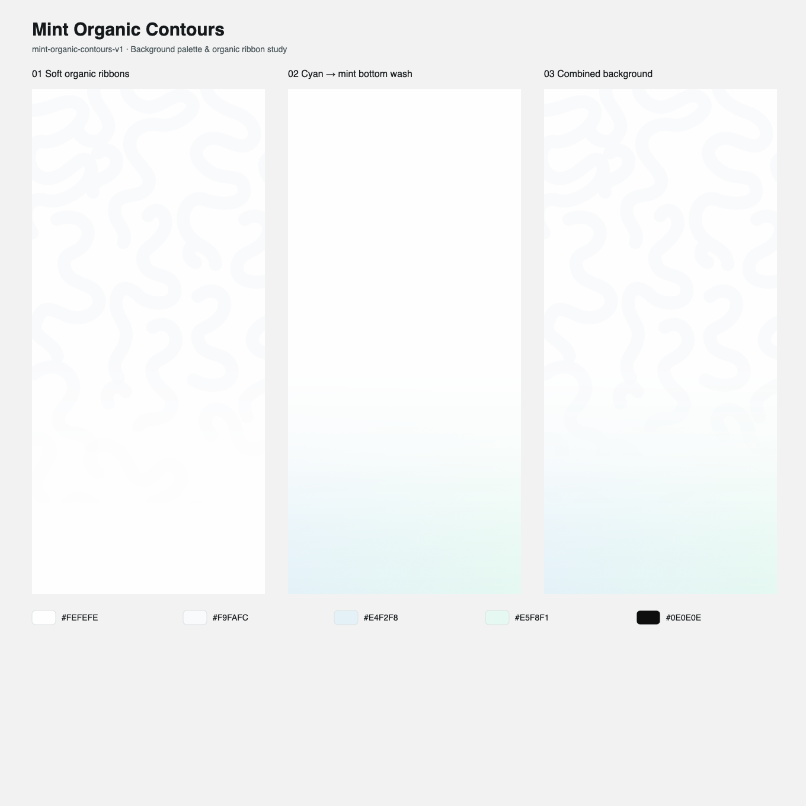

# 薄荷流纹 · Mint Organic Contours

风格标识：`mint-organic-contours-v1`。从本次用户提供的三屏参考图中提取背景配色与图案，保存为 `onboarding-design` 可加载的命名风格。本次范围为风格提取与背景资源，不生成特定产品的引导流程。



## 配色

| 用途 | Token | 色值 | 来源 |
| --- | --- | --- | --- |
| 近白底色 | `background` | `#FEFEFE` | 截图亮色区域高频代表色 |
| 极浅灰曲带 | `pattern` | `#F9FAFC` | 同区域高频代表色 |
| 底部左侧雾蓝 | `wash_cyan` | `#E4F2F8` | 中间屏底部左侧局部中位数 |
| 底部右侧薄荷绿 | `wash_mint` | `#E5F8F1` | 中间屏底部右侧局部中位数 |
| 主按钮 | `primary` | `#0E0E0E` | 按钮内部局部中位数 |
| 主文字 | `text_primary` | `#15191B` | 本次重建值 |
| 次文字 | `text_secondary` | `#465357` | 本次重建值 |

截图存在缩放和像素混合，以上采样表示近似代表色，不等同于原始设计文件的 token。采样区域、方法与原图 SHA-256 记录在 Profile 中。图外 `#F2F2F2` 属于拼图展示底，不用于 App 背景。

## 背景图案与层次

背景是宽圆头的有机曲带，以不规则 C/U/S 弯和回环形成松散纹样。形状在边缘可裁切，方向自然变化；不是细线波浪、密集平行等高线或高对比迷宫。参考中的人物、星光、钱包、纸币、店铺和存钱罐属于前景，不纳入背景。

图层从下到上：

1. 不透明近白 `#FEFEFE` 全屏底色。
2. `#F9FAFC` 宽曲带。393×852 pt 设计基准下线宽 22 pt，允许范围 18～28 pt，圆头圆角；上部覆盖约 25%～40%，保留白色通道。
3. 左雾蓝、右薄荷绿的水平渐变色面，通过纵向遮罩从中下部向底部显现。

曲带遮罩按全屏 y 坐标控制：`0 / 0.50 / 0.70 / 0.82 / 1` 对应 `1 / 1 / 0.15 / 0 / 0`。蓝绿底晕的纵向显色强度：`0 / 0.56 / 0.72 / 0.88 / 1` 对应 `0 / 0 / 0.22 / 0.78 / 1`。在 stop 间线性插值，正文区域降低纹样存在感。

这些路径、pt、覆盖率和 stop 是依据观察制定的重建规范，并非反推出的原图参数。`background.svg` 提供固定贝塞尔路径作为本风格的可用背景资产，同流程保持相同路径锚点。跨屏幕等比 cover 并裁切纹样；渐变按整个屏幕坐标绘制。

## 可直接使用的背景提示词

> 创建移动 App 的纯背景，采用「薄荷流纹」风格：近白 #FEFEFE 底色，上部叠加极低对比的 #F9FAFC 宽圆头有机曲带。曲带以不规则 C/U/S 弯和短回环自然蜿蜒，方向多变、边缘局部裁切，保留大量白色通道；不要形成密集平行等高线或规则迷宫。393×852 逻辑 pt 基准下线宽约 22 pt。曲带在上部可见，向文案所在的中下部逐步消隐，y=0.82 后不可见。底部是左侧雾蓝 #E4F2F8 到右侧薄荷绿 #E5F8F1 的水平色彩过渡，再通过纵向渐隐与白底融合：全屏 y=0、0.56、0.72、0.88、1 对应显色强度 0、0、0.22、0.78、1。整体平滑、轻盈、二维、低饱和，无硬边、无颗粒。仅输出背景，不含人物、物品、品牌、文字、按钮、进度、状态栏或设备外壳。

**负向提示词**：高对比纹样、细碎波纹、密集平行等高线、硬折角、明显小块平铺、霓虹光团、彩虹渐变、强投影、纸纹、颗粒、玻璃、厚重 3D、金融道具、品牌或整屏 UI。

**完整 UI 组合时**：背景独立；上半部按真实产品能力安排主视觉，下部居中短标题、说明、进度和黑色胶囊 CTA。可选主视觉使用细灰轮廓、淡青绿平涂与轻微明暗，不强制添加金融场景。标题可用粗衬线、正文用系统无衬线，中文采用合适回退；精确原字体未知。所有文字和交互用原生控件，字号与安全区跟随系统。

## 文件与复用

- 正式风格：[保存的 Profile](../../skills/onboarding-design/styles/mint-organic-contours-v1.json)。
- 交付快照：[style-profile.json](style-profile.json)，内容与正式 Profile 相同。
- 矢量背景：[background.svg](background.svg)，393×852，可缩放，非原图抠图。
- 分层预览：[style-preview.svg](style-preview.svg) / [style-preview.png](style-preview.png)。
- 原始参考：[reference.png](../../skills/onboarding-design/references/mint-organic-contours-v1/reference.png)，保留原字节。

后续请求可直接使用：

```text
使用 onboarding-design
style_id: mint-organic-contours-v1
profile_store: /Users/hocgin/Projects/agent-skills/skills/onboarding-design/styles
项目类型: 实际 App 类型
核心功能: 实际产品能力
```

读取规范：

```bash
python3 skills/onboarding-design/scripts/onboarding.py load-profile \
  --style-id mint-organic-contours-v1 \
  --store skills/onboarding-design/styles
```

加载完整 JSON 后复用，不依赖跨聊天记忆或再次上传图片。跨项目可指定上述绝对存储路径，也可复制 JSON 及参考目录；SVG 是独立资源，使用时一并复制。改配色、路径尺度或渐变曲线时派生新 ID，保留 v1。

## 实现与验收范围

背景可使用 SVG、CSS 遮罩或原生 Canvas/Path 绘制。按 393×852 逻辑 pt 保持纹样比例，背景可出血；文案与 CTA 留在系统安全区。纹样为纯装饰，不拦截触摸，不进入读屏顺序。背景固定，无持续滚动或闪烁；动效规范为本次主动建议，参考静图无法证明实际动画。

| 七维检查 | 本次结果与证据 |
| --- | --- |
| 风格一致性 | 已检查：三屏参考的共同配色与曲带统一到一个 Profile；分层预览与 token 一致 |
| 产品相关性 | 本次仅背景：移除品牌、金融对象及业务文案；具体产品映射留待实际适配 |
| 构图质量 | 已检查背景预览：上部纹样、下部底晕与纹样消隐；未验证真实文案排版 |
| 内容完整性 | 风格交付完整；本次不要求产品 Flow，因此未创建虚构流程 |
| 提示词可执行性 | 已明确色值、形状、位置、层次、遮罩及排除项；SVG 提供直接实现资产 |
| 可复用性 | 已检查：同一背景可用于阅读、任务等产品，核心没有业务对象；Profile 可保存并加载 |
| 可实现性 | 已渲染并目视检查 SVG 预览；Profile 结构校验与保存/加载一致性检查完成 |

验证限于风格规范与背景资源。未生成完整 App 页面、未编译原生项目、未做设备运行或原图像素匹配验收。
