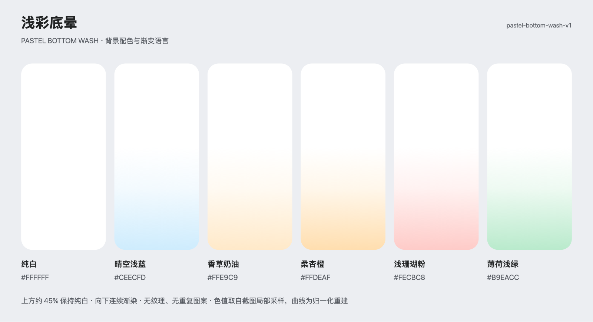

# 浅彩底晕 · Pastel Bottom Wash

风格标识：`pastel-bottom-wash-v1`。从用户提供的八屏引导拼图中提取，范围为背景配色及图形语言；未创建新的产品引导流程。



## 背景与配色

主要特征为纯白大留白，向底部缓慢扩散的低饱和彩色渐变。图中没有可见的重复纹样、网格、点阵、噪点或背景插画；所谓“图案”主要来自前景的大数字、简单弧形、箭头和单个圆环。背景层与这些内容层应独立。

| 纯白 | `white` | `#FFFFFF` |
| 晴空浅蓝 | `cyan` | `#CEECFD` |
| 香草奶油 | `cream` | `#FFE9C9` |
| 柔杏橙 | `apricot` | `#FFDEAF` |
| 浅珊瑚粉 | `blush` | `#FECBC8` |
| 薄荷浅绿 | `mint` | `#B9EACC` |

黑色按钮：`#000000`，主要文字：`#202223`，白色按钮文字：`#FFFFFF`。可选强调色为蓝 `#3AB3EB`、橙 `#F99405`、珊瑚红 `#FA564C`、绿 `#1CCD7B`，用于单个数字或图形，不能拿来替代浅色背景。

这些颜色来自本张截图的指定局部区域中位数，可能受截图缩放、色彩管理与像素波动影响；它们是可复用的近似代表色，并非原始设计文件的精确 token。采样坐标、筛选方法和原图 SHA-256 均保存在 Profile 的 `provenance.color_sampling` 与 `references` 中。拼图外侧灰蓝色 `#CFD3DE` 只属于展示画布，不纳入 App 背景。

## 稳定图形规则

- 渐变只沿垂直方向；上部约 45% 保持纯白，下部逐渐显色，无硬边。
- 重建 stop 为 `0 / 0.45 / 0.67 / 1.0`，各处端色混合强度为 `0 / 0 / 0.25 / 1`；混色基底为不透明白色。
- 一页选择一个已登记变体；整组共用相同方向、曲线、留白和黑色交互，不临时发明新颜色。
- 默认 `cyan`；可按叙事语义预先绑定 `cream / apricot / blush / mint`，纯白用于中性或休止页。变体不是用户状态的唯一提示。
- 没有内容需求时，背景保持空白。大数字、弧形、圆环是可选前景，必须对应真实产品内容；单页一个主图形，最多一个辅助符号。
- 不继承原品牌、文案、数字、系统权限弹窗或固定百分比；圆环只是可选几何表达，不定义整套背景为 3D。

渐变 stop、pt 尺寸、字体与动效时长均为本次主动重建值，静态参考图无法证明原始动效或精确字体。

## 可直接使用的背景提示词

> 创建极简移动 App 背景，采用「浅彩底晕」语言。上方约 45% 是干净纯白 #FFFFFF，大面积无纹理留白；自中部以下沿垂直方向自然过渡至底部。默认使用晴空浅蓝 #CEECFD 作为底端色。渐变 stop 为 0、0.45、0.67、1，相对于整个画布；对应白色到端色的不透明混合强度为 0、0、0.25、1。背景平滑、轻盈、低饱和，只有一个浅彩色域，不添加具象物、文字、按钮或外框。换用批准变体时仅替换端色，白底、曲线和留白保持一致。

**负向提示词**：重复纹样、点阵、网格、颗粒噪点、纸纹、背景插画、径向霓虹光团、强光斑、暗角、硬色块边界、彩虹渐变、整屏浓色、玻璃或金属背景、物体投影、参考品牌与原文案。

**UI 组合补充**：如用于完整页面，独立叠加一个真实产品信息焦点、居中短标题、可选语义图形、顶部细分段进度和底部黑色圆角 CTA。全部文案和交互使用原生控件；不把这些元素烘焙进背景。

## 保存与复用

唯一保存规范：[Style Profile](../../.onboarding-design/styles/pastel-bottom-wash-v1.json)。原始参考：[reference.png](../../.onboarding-design/references/pastel-bottom-wash-v1/reference.png)，保留原文件字节，未进行编辑。Profile 的参考路径相对于 `.onboarding-design/styles/`；后续复用不必再次上传图片。

在当前项目中使用：

```text
style_id: pastel-bottom-wash-v1
profile_store: /Users/hocgin/Projects/agent-skills/.onboarding-design/styles
背景变体: cyan
项目类型: 你的实际 App 类型
核心功能: 你的实际产品能力
```

也可读取完整规范后交给 `onboarding-design`：

```bash
python3 skills/onboarding-design/scripts/onboarding.py load-profile --style-id pastel-bottom-wash-v1 --store .onboarding-design/styles
```

跨项目时指定上述存储目录，或把 JSON 与参考目录一起复制过去。修改端色、渐变曲线等固定参数时派生新 ID，不覆盖 v1。

## 实现与检查

SwiftUI 可用 `LinearGradient`、原生文字、`Shape/Path` 和按钮实现，不需要生成背景位图。按各 stop 的混色结果提供不透明颜色，坐标对应全屏，背景可出血，交互和文案保留系统安全区。简单弧形、进度和圆环也可用代码实现，复杂前景独立处理。

本次完成原图观察、局部颜色采样、Profile 结构校验、本地保存与加载检查。颜色体系、无纹样规则、背景/内容分层和实现路径已核对。产品相关性与流程完整性需在具体产品适配时检查；未生成产品页面，也未进行设备运行或原始设计文件的像素级匹配验收。
