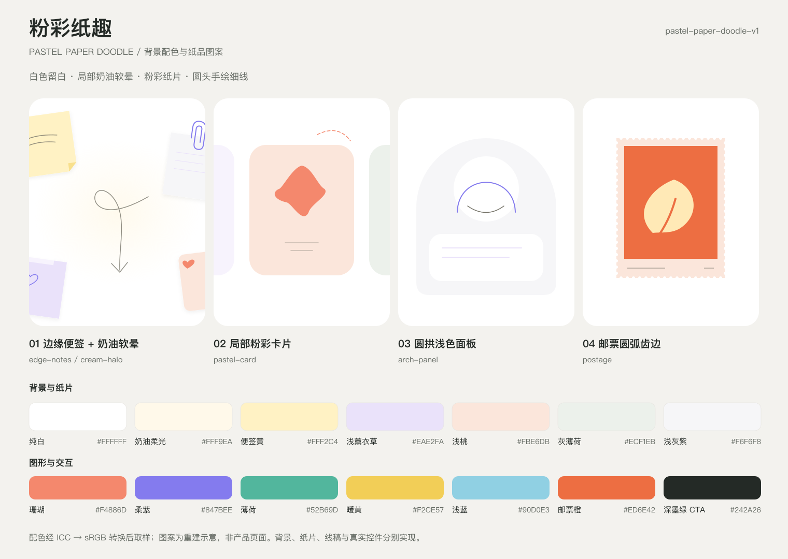

# 粉彩纸趣 · Pastel Paper Doodle

风格标识：`pastel-paper-doodle-v1`。依据用户提供的六屏引导拼图，提取背景配色与纸品、手绘图案语言。本次仅创建可复用风格，不假定产品用途或生成产品流程。



## 配色

| 用途 | Token | sRGB 代表色 |
| --- | --- | --- |
| 主背景、纸面 | `background` | `#FFFFFF` |
| 局部奶油柔光 | `cream_glow` | `#FFF9EA` |
| 便签黄 | `paper_yellow` | `#FFF2C4` |
| 浅薰衣草纸片 | `paper_lilac` | `#EAE2FA` |
| 浅桃面板、邮票边框 | `paper_peach` | `#FBE6DB` |
| 灰薄荷面板 | `paper_mint` | `#ECF1EB` |
| 圆拱浅灰紫面板 | `surface_lilac` | `#F6F6F8` |
| 中性容器 | `surface` | `#F2F2F2` |
| 小面积浅蓝提示底 | `wash_cyan` | `#EDF5F9` |
| 珊瑚色图形 | `accent_coral` | `#F4886D` |
| 柔紫图形 | `accent_violet` | `#847BEE` |
| 薄荷图形 | `accent_mint` | `#52B69D` |
| 暖黄图形 | `accent_yellow` | `#F2CE57` |
| 浅蓝图形 | `accent_cyan` | `#90D0E3` |
| 邮票橙 | `stamp_orange` | `#ED6E42` |
| 邮票奶油色图形 | `stamp_cream` | `#FFE9B6` |
| 主文字、主按钮 | `text_primary` / `primary` | `#242A26` |

原图内嵌名称为 `Display` 的 ICC 配置。采样先通过 Pillow ImageCms 将原图转换为 **sRGB**，再取无文字局部区域的逐通道中位数；饱和图形先筛选像素。原图坐标、筛选条件、ICC 处理方式和 SHA-256 均记录在 Profile 中。这些色值是截图的局部代表色，不代表已取得原设计 token。

辅助文字 `#656B64`、线稿 `#747267`、未激活进度 `#D9D9D7` 是重建规范值。`presentation_canvas: #E5E5E5` 是拼图外部灰底，不用于 App 内背景；预览板外底同样只用于展示。

## 背景与图案规则

核心是白色大留白、局部粉彩纸面和稀疏线稿。没有均匀重复的背景纹样，也没有可见的全屏纸张纤维或颗粒噪点。

| 变体 | 组合方式 |
| --- | --- |
| `plain` | 白底，无装饰，适合需要集中注意力的内容页 |
| `cream-halo` | 一处低对比奶油色椭圆软晕，最多配一条弧形涂鸦 |
| `edge-notes` | 白底，可配奶油软晕；2～4 张粉彩纸片锚定边缘，单片约 20%～40% 被裁切，中央留白 |
| `pastel-card` | 单个浅桃、浅紫或灰薄荷主卡片；相邻卡片可露出很窄的边缘，仍作为同一个面板组 |
| `arch-panel` | 单个浅灰紫圆拱面板，上方半圆，底部平直或圆角 |
| `postage` | 浅桃纸框搭配均匀圆弧齿边，内部为橙色和奶油色的产品语义图形 |

每屏选择一个布局族。圆拱、邮票与边缘便签不同时堆叠。允许纯白的休止页，不要求每页都有图案。

- 便签参考尺寸为 84×120 pt，平面旋转范围为 −9°～9°；每张至多增加一种细节：折角、胶带或回形针。纸片只用极轻向下柔影。
- 手绘线稿默认 1.5 pt，圆头圆角，轻微不对称；可选环绕箭头、空心爱心、四角星或短虚线轨迹。每屏最多 3 处线稿，和纸片组成装饰组时总共最多 4 组。
- 邮票齿边可用半径 3 pt、节距 12 pt 的半圆切口重建。预览中的叶片为替换示意，不继承参考品牌图形。
- 奶油软晕以全画布归一化坐标绘制：中心 `(0.5, 0.55)`，椭圆半径 `(0.38W, 0.22H)`；径向 stop 为 `0 / 0.55 / 1`，透明度 `0.85 / 0.35 / 0`。它是一个局部色层，不是向底部铺满的渐变。
- 默认有色装饰占画布约 8%～30%，主面板页可到 40%；文案四周至少 24 pt 无装饰间隙。大字号或小屏优先减少装饰。

几何、留白预算、阴影、字体和动效都是本次主动重建的规范值，不能从静态截图反推原始参数。参考中的角色、计时圆环、输入框和开关属于前景内容或交互，不固化为背景图案。

## 提示词

背景生成时，加载完整 Profile，并选定一个 `background_variants` 键。下面以 `edge-notes` 为例，可直接使用；切换到其他变体时替换相应图案段落，不叠加全部图案。

> 创建采用「粉彩纸趣」语言的移动 App 背景。白色 #FFFFFF 占主导，中央大片留白。沿左右边缘布置 2～4 张哑光粉彩纸片，使用便签黄 #FFF2C4、浅薰衣草 #EAE2FA、浅桃 #FBE6DB，单片裁切约 20%～40%，平面内轻微旋转 −9°～9°。每张只配一种折角、胶带或回形针细节，投影极轻。中央偏下可有一处奶油色 #FFF9EA 椭圆软晕，柔和消失于白底；全画布归一化中心为 (0.5, 0.55)，半径为 (0.38W, 0.22H)，径向 stop 0 / 0.55 / 1 对应透明度 0.85 / 0.35 / 0。少量 1.5 pt 圆头手绘线，颜色 #747267、透明度 0.8，最多 3 处，采用不完全规整的弧形箭头、爱心或四角星。装饰总共最多 4 组，有色区域约占画布 8%～30%，避免中央文字预留区。正视二维、平滑纸片色面、轻松温柔。不要生成文字、按钮、状态栏、手机外壳或品牌角色。

**负向约束**：全屏牛皮纸、粗纸纤维、噪点、重复贴纸底纹、网格、点阵、霓虹、强光斑、重阴影、玻璃、黏土 3D、金属、复杂透视、图案堆满、原品牌角色、原文案与数值。

完整 UI 组合时，文案、按钮、输入框和进度另用真实控件实现。标题使用偏圆润的粗无衬线，参考 32/38 pt；正文参考 17/25 pt。主按钮为 `#242A26` 底、白字，54 pt 起高、28 pt 圆角，左右留 28 pt。纸片上的手写字只作非信息性点缀，不能承担必要说明。

## 保存与复用

唯一保存规范：[Style Profile](../../.onboarding-design/styles/pastel-paper-doodle-v1.json)。[原始参考图](../../.onboarding-design/references/pastel-paper-doodle-v1/reference.png) 保留原文件字节与 ICC 配置，未编辑。Profile 中的参考路径相对于 `.onboarding-design/styles/`。

```text
使用 onboarding-design
style_id: pastel-paper-doodle-v1
profile_store: /Users/hocgin/Projects/agent-skills/.onboarding-design/styles
背景变体: edge-notes
项目类型: 你的实际 App 类型
核心功能: 你的真实产品能力
```

```bash
python3 skills/onboarding-design/scripts/onboarding.py load-profile --style-id pastel-paper-doodle-v1 --store .onboarding-design/styles
```

复用时加载完整 JSON，而不只传递风格 ID 标签。跨项目可指定上述存储目录，或复制 Profile 与参考目录。后续修改固定色板、材质或图案规则时派生新 ID。原有 `pastel-bottom-wash-v1` 保持独立。

## 实现与验证范围

白底、椭圆柔光、纸片、折角、胶带、手绘线和齿边都可用 SVG、Canvas 或原生 Path 实现，无需生成背景位图。背景、装饰、语义主视觉和真实控件分层；装饰禁用命中测试并从辅助功能树隐藏。复杂插画按产品内容另行制作。

正文在白底使用主文字或辅助文字；浅彩面板上的正文统一用 `text_primary`。不要直接把辅助灰字放在浅紫纸片上：该组合计算对比度低于 4.5:1，已排除。浅彩与强调色只负责纸面和图形，不能当作小字颜色或状态的唯一表达。

| 检查 | 结果与证据 |
| --- | --- |
| 风格一致性 | 已核对四种重建图案示意，共用同一色板、平面纸品材质和细线语言 |
| 产品相关性 | 本次不适用；未指定产品，不把原 App 的角色或能力写入复用核心 |
| 构图质量 | 已查看导出的预览 PNG，标签清楚，装饰稀疏；实际页面安全区与动态字号仍需产品适配验证 |
| 流程完整性 | 本次不适用；交付为命名风格，不是引导流程 |
| 提示词可执行性 | 已明确变体、颜色、位置、几何、密度和负向约束；未执行 AI 出图 |
| 可复用性 | 已通过 Profile 结构校验与保存/加载一致性检查，原始参考 SHA-256 一致 |
| 可实现性 | 已生成并查看 SVG/PNG 示意；已计算指定文字组合对比度，未编译或运行 App |

白字/深墨绿 CTA 对比度约 **14.64:1**，深墨绿字/浅桃约 **12.16:1**，辅助灰字/白底约 **5.47:1**。这些是指定不透明颜色组合的计算结果，不代表实际设备、所有叠层或完整产品页面通过验收。
