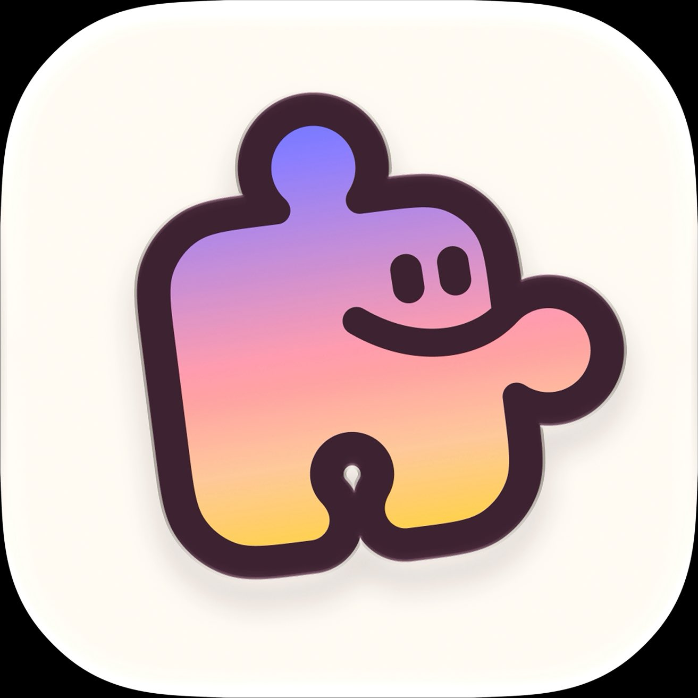
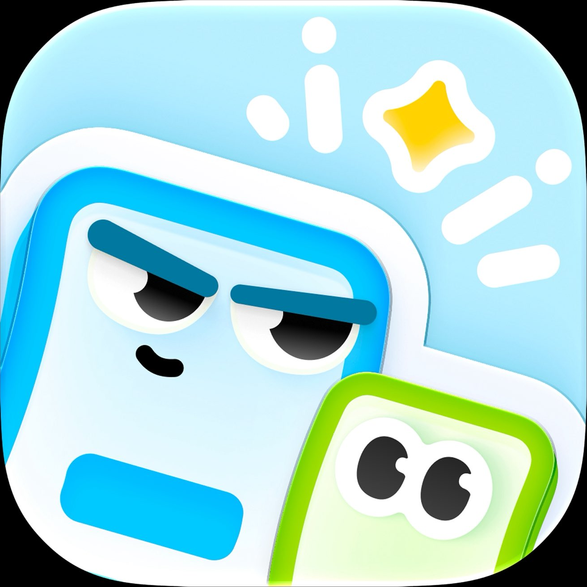
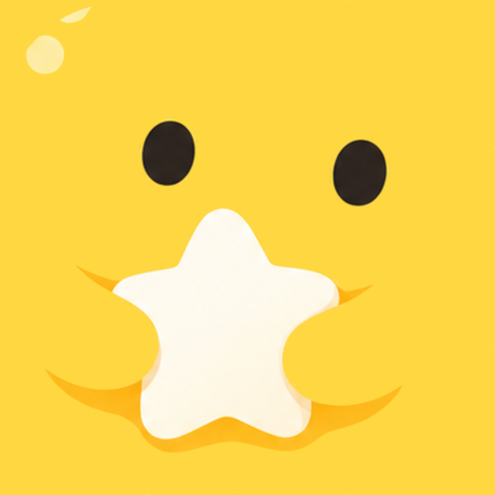
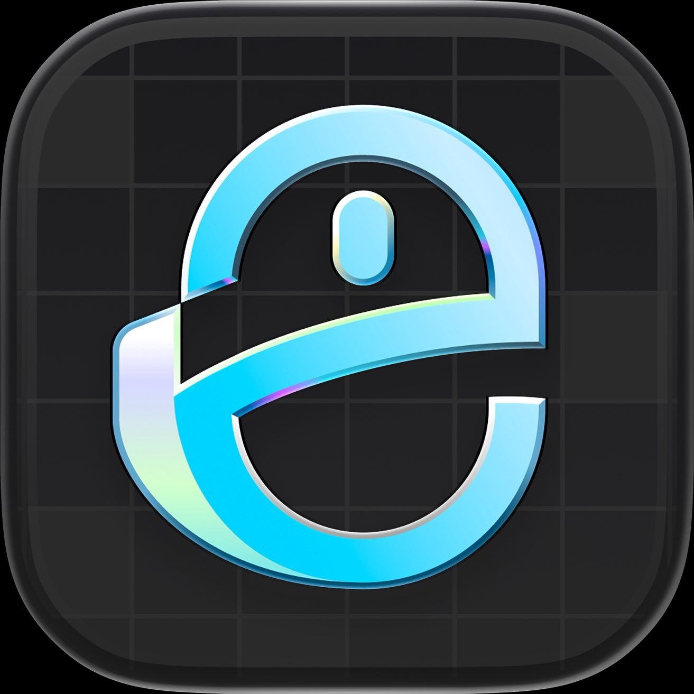
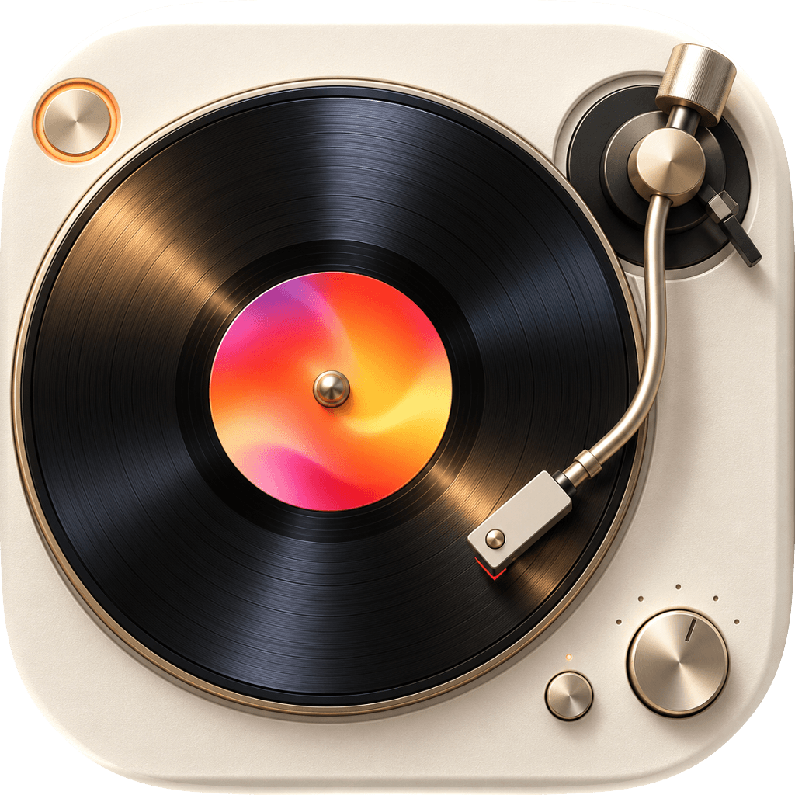
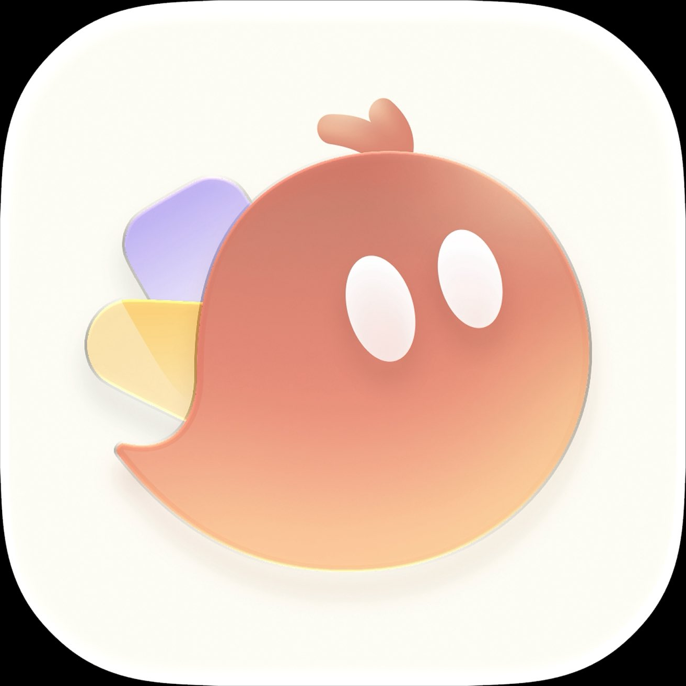
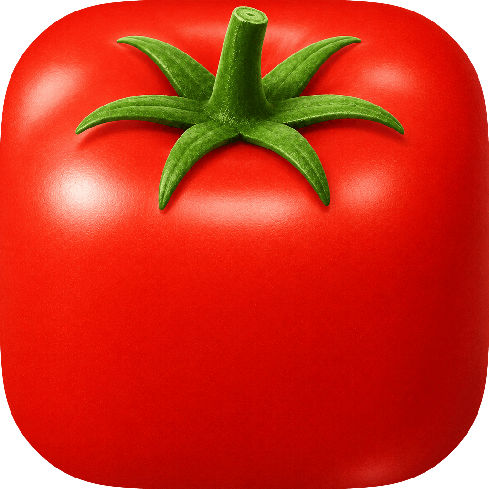
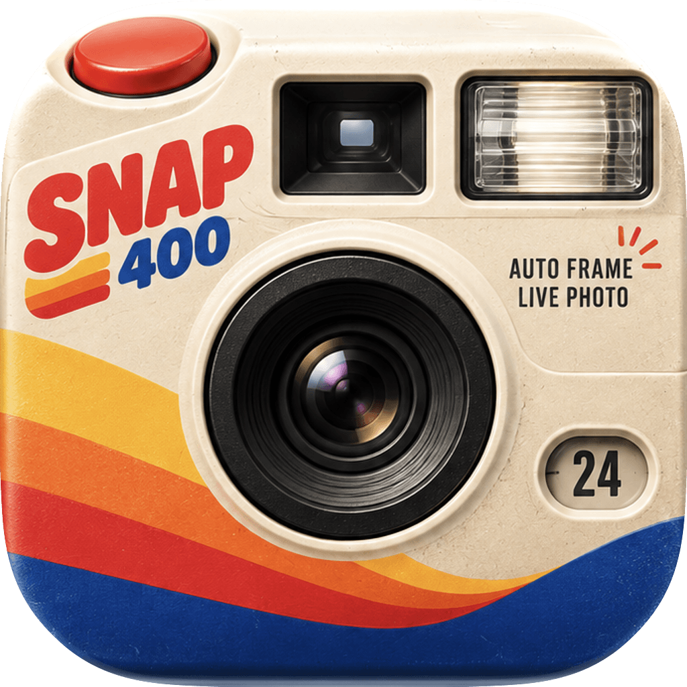

# App Icon 风格目录

> 本文件由 `python3 scripts/build_prompt.py --catalog` 自动生成，请勿手动编辑。匹配规则见 [styles/index.md](styles/index.md)。

共 10 套风格。

| 参考图 | 风格 | 描述 | 色板 |
|---|---|---|---|
|  | **[粗线萌徽](styles/bold-mascot/style.md)** `bold-mascot` | 暖白底上单个圆润拟人徽章，深梅色极粗圆头描边包住紫粉金连续渐变，同色极简眼睛与大弯笑线，浅浮雕投影带来软胶贴章感。 | `#FFFBF3` `#422234` `#8771F7` `#F39BC0` `#FFA69F` `#FFDA68` |
|  | **[叠贴搭档](styles/buddy-tiles/style.md)** `buddy-tiles` | 浅青底上一主一辅两个拟人厚贴片组成一个标志，宽白色软边 + 浅色内面 + 大眼神互动，青蓝 / 酸橙双色，配一枚黄色星芒，2.5D 软塑料质感。 | `#AEF0FC` `#00BFEF` `#DDF8FD` `#007D9C` `#93D900` `#F1FFDD` `#FAFEFF` `#161A1C` `#FFD000` |
|  | **[萌脸特写](styles/cozy-face/style.md)** `cozy-face` | 单色无轮廓萌物脸超近景铺满画布，两颗深色竖椭圆眼、无嘴，奶白圆胖物件作为焦点，同色相深一阶柔边阴影，极简扁平。 | `#2C241F` `#FEF9E9` `#F9DA9A` `#FFB37A` `#F08A4B` `#FF9EB5` `#E8738F` `#8EDDB4` `#5DBE8E` `#8CCBFF` `#5BA6E8` `#C3A8FF` `#9C7FE6` `#FF8A7A` `#E5604F` `#FFD741` `#FEBB1E` |
|  | **[虹彩带标](styles/holo-ribbon/style.md)** `holo-ribbon` | 炭黑低对比细网格底上单个连续宽带字母，亮青到冰蓝的宽正面配窄边局部虹彩，细白上亮边与深色内侧形成浅立体折带感，克制科技。 | `#232323` `#343434` `#00C8EE` `#A4EDFF` `#F3FFFA` `#BFA5FF` `#C8FFD6` `#FFF5B4` |
|  | **[果冻字块](styles/jelly-letter/style.md)** `jelly-letter` | 近白柔光底上 2–4 个圆胖半透明 3D 果冻字母成组，每个字母一种糖果色、左上弧形高光，向底色晕出同色柔光，外沿两组白色胶囊短线。 | `#F7FBFE` `#F5E4F6` `#FAEBD6` `#89FA9A` `#69E184` `#5AA6F6` `#EC799B` `#E84579` `#FAE352` `#F4B840` `#357A5D` `#FAFCFC` |
|  | **[香槟拟物](styles/luxe-skeuo/style.md)** `luxe-skeuo` | 高端精密器物顶面俯视铺满画布，暖米白粉末喷涂 + 香槟金拉丝金属 + 光泽黑三材质，唯一的粉橙黄流体渐变色彩焦点，柔和棚拍光，精致克制。 | `#E4D9C9` `#D3C5B5` `#2D2F36` `#C9AE8A` `#826F5C` `#CD3C8D` `#FC4623` `#FC663E` `#FDA147` |
|  | **[柔彩灵物](styles/pastel-spirit/style.md)** `pastel-spirit` | 奶白底上一个蜜桃渐变的浅厚度半透明萌物，乳白细亮边与两颗白色椭圆眼（无瞳无嘴），后置淡紫 / 奶黄软片，低对比柔影，轻盈梦幻。 | `#FFFFF7` `#D98C7C` `#F0A18D` `#FFD39E` `#CBBBF4` `#FFE59A` `#FFF9F5` `#FFF1D6` |
|  | **[彩泡字块](styles/pop-letter/style.md)** `pop-letter` | 纯黑底上 2–4 个圆胖泡泡字母紧密成组，每个字母一种高饱和糖果色、完全扁平，黑色细缝分隔，外沿两组白色动感短线。 | `#000000` `#33F97E` `#228EFC` `#FD6682` `#FFD236` `#FFFFFF` |
|  | **[实物塑形](styles/real-morph/style.md)** `real-morph` | 真实物体本身被塑形成饱满圆角方块并铺满画布，超写实表皮与固有色，只保留一个最具辨识度的局部特征，左上柔和大高光。 |  |
|  | **[复古彩条](styles/retro-stripe/style.md)** `retro-stripe` | 70 年代米白磨砂塑料器物正面铺满画布，黄橙红钴蓝四色丝印彩条涂装 + 一个近黑凹陷焦点部件 + 红色点缀，柔和棚拍光与细微印刷颗粒。 | `#ECDCC5` `#F2BD4B` `#E97134` `#CF312B` `#15377F` `#D9392F` `#111111` |
