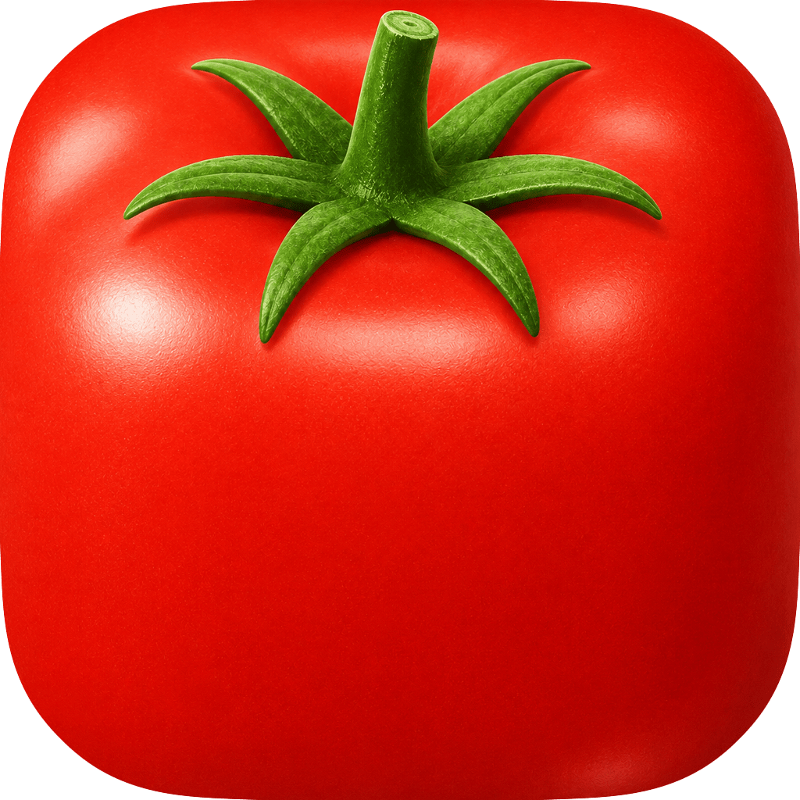
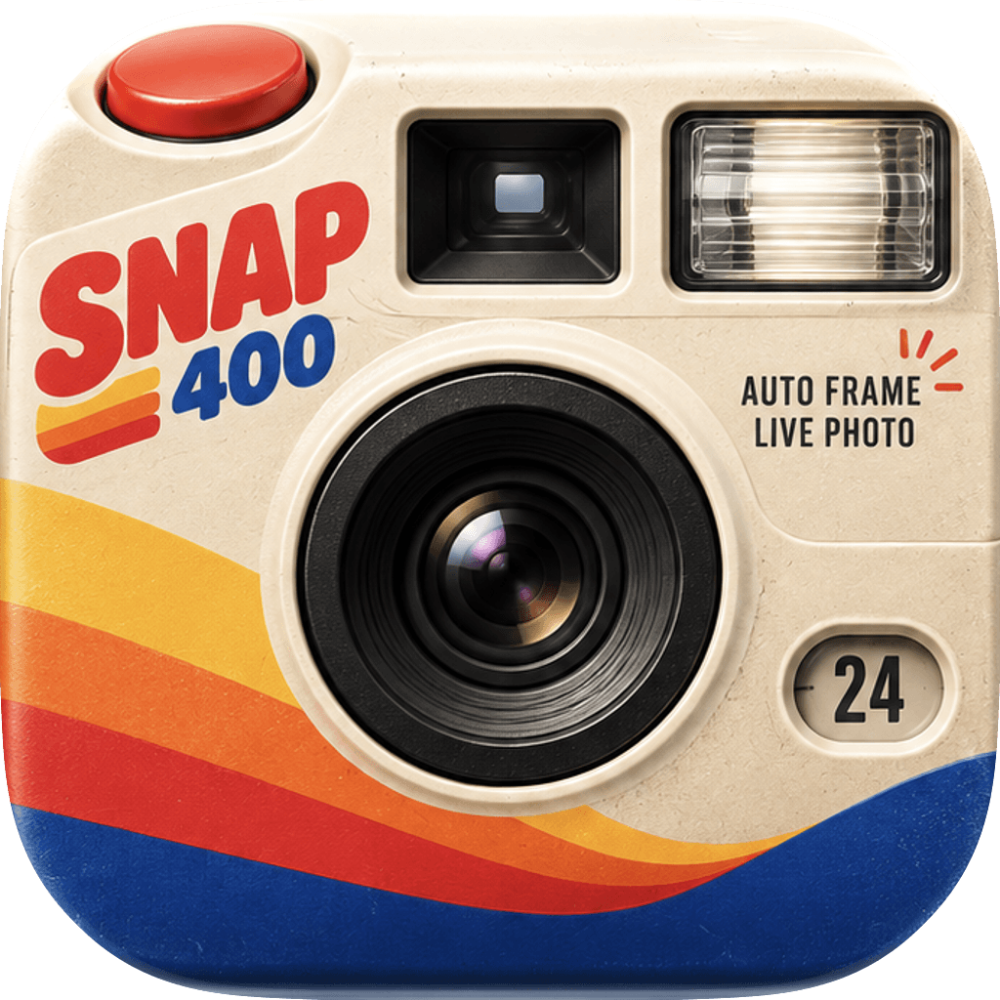

# App Icon 风格目录

> 本文件由 `python3 scripts/build_prompt.py --catalog` 自动生成，请勿手动编辑。匹配规则见 [styles/index.md](styles/index.md)。

共 6 套风格。

| 参考图 | 风格 | 描述 | 色板 |
|---|---|---|---|
|  | **[萌脸特写](styles/cozy-face/style.md)** `cozy-face` | 一张纯色萌物脸部超近景铺满画布，两颗黑色椭圆小眼睛，圆胖小爪子在下方抱住一个奶白色软物件，暖橙色柔和弧形阴影，极简扁平带轻微柔光。 | `#FFD741` `#FEBB1E` `#2C241F` `#FEF9E9` `#F9DA9A` `#FEEBA3` |
|  | **[果冻字块](styles/jelly-letter/style.md)** `jelly-letter` | 白色柔光底上 2–4 个圆胖 3D 果冻字母拼块，每个字母一种糖果色、通透光泽高光，四周晕出同色彩色柔光，两侧白色胶囊短线。 | `#F7FBFE` `#F5E4F6` `#FAEBD6` `#89FA9A` `#69E184` `#5AA6F6` `#EC799B` `#E84579` `#FAE352` `#F4B840` `#357A5D` `#FAFCFC` |
|  | **[香槟拟物](styles/luxe-skeuo/style.md)** `luxe-skeuo` | 暖米白磨砂机身的高端 Hi-Fi 器物俯视铺满画布，香槟金拉丝金属部件 + 黑色光泽主体，中心一块粉橙黄流体渐变色彩焦点，柔和棚拍光，精致克制。 | `#E4D9C9` `#D3C5B5` `#2D2F36` `#C9AE8A` `#826F5C` `#CD3C8D` `#FC4623` `#FC663E` `#FDA147` |
|  | **[彩泡字块](styles/pop-letter/style.md)** `pop-letter` | 纯黑底上 2–4 个圆胖泡泡字母紧密拼成方块，每个字母一种高饱和糖果色，黑色细缝分隔，两侧白色短促动感线。 | `#000000` `#33F97E` `#228EFC` `#FD6682` `#FFD236` `#FFFFFF` |
|  | **[实物塑形](styles/real-morph/style.md)** `real-morph` | 一个真实物体被「捏」成 iOS 圆角方块形状并铺满整个画布，物体本身就是图标外形；超写实材质与表皮纹理，固有色饱满，顶部保留最具辨识度的特征部件。 | `#D80801` `#9E0804` `#558012` `#243E02` `#466B0C` `#FDE6DC` |
|  | **[复古彩条](styles/retro-stripe/style.md)** `retro-stripe` | 米白磨砂塑料的 70 年代消费电子正面铺满画布，黑色大镜头式焦点 + 左下扫向右下的黄橙红蓝复古彩条，柔和棚拍光与细微印刷颗粒。 | `#ECDCC5` `#F2BD4B` `#E97134` `#CF312B` `#15377F` `#D9392F` `#111111` |
