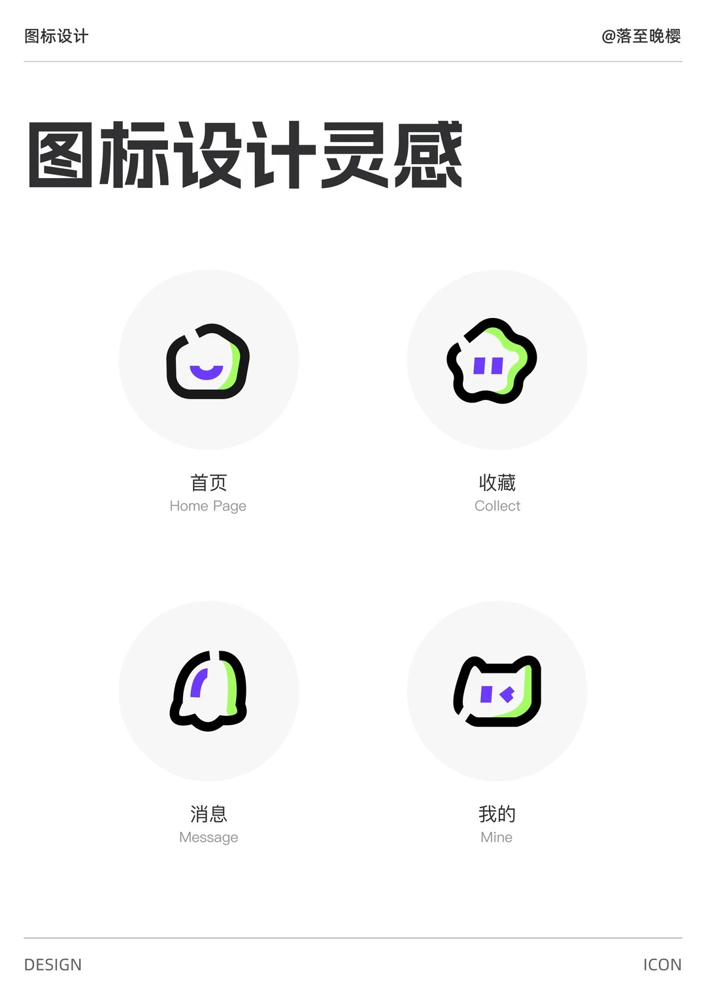
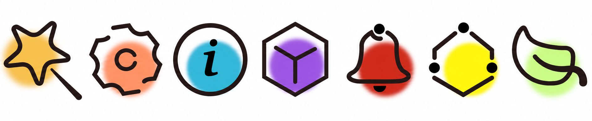
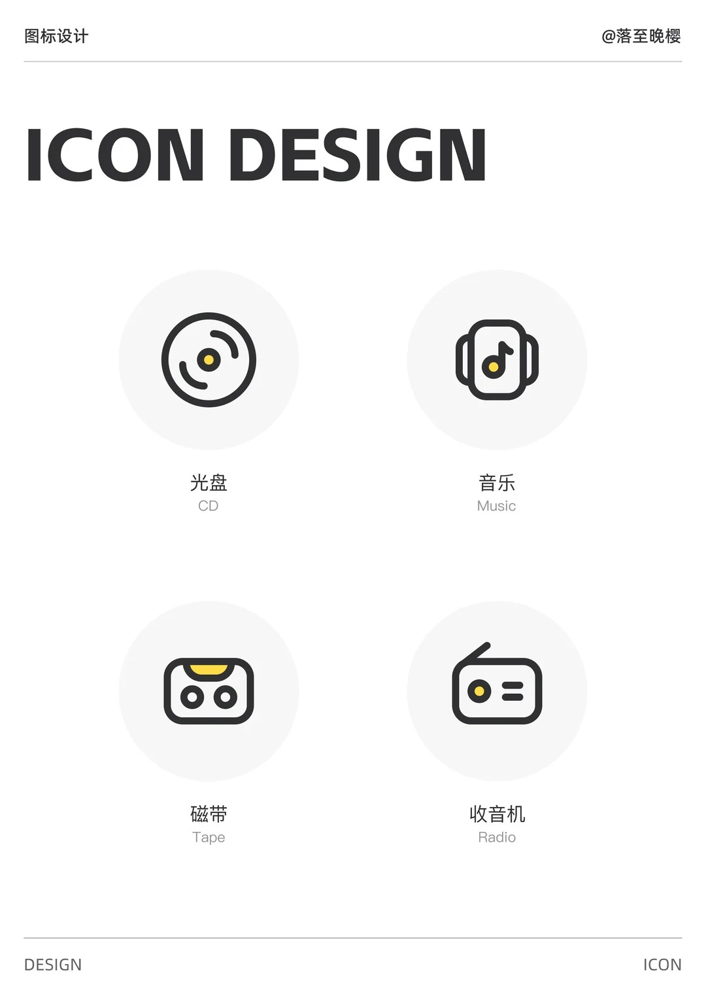
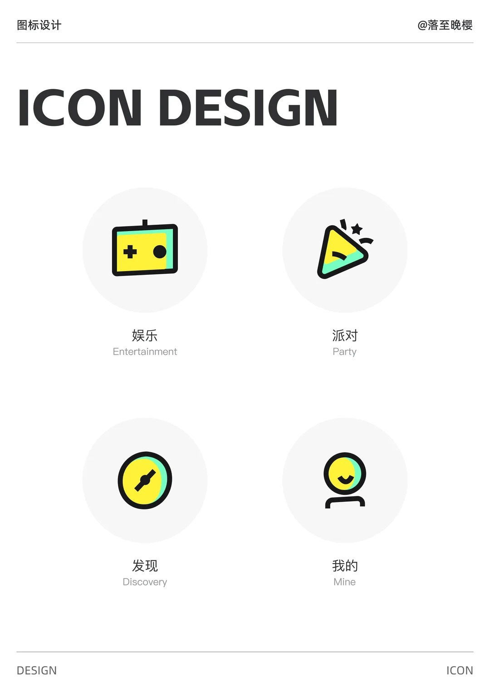

# 主题目录

> 本文件由 `python3 scripts/build_prompt.py --catalog` 自动生成，请勿手动编辑。选择规则见 [themes/index.md](themes/index.md)。

共 8 套主题。

| 参考图 | 主题 | 风格 | 色板 |
|---|---|---|---|
|  | **[涂鸦萌宠](themes/doodle-buddy/theme.md)** `doodle-buddy` | 粗黑断口手绘轮廓 + 紫色极简表情 + 青柠绿内侧月牙阴影，物体被拟人化为软萌小生物。 | `#1A1A1A` `#6B3CF6` `#A8F25C` `#FFFFFF` `#F5F5F5` |
|  | **[固有色扁平](themes/flat-object/theme.md)** `flat-object` | 无描边的小巧实物剪影，按物体固有色上色，同色系深浅两阶表现结构，像精简版 emoji，一眼可认。 | `#E2E2E2` `#CFCFCF` `#5B9BF0` `#DFE0E0` `#C5866D` `#9A4A30` `#8DC86A` `#8475E0` `#DFDAF5` `#DB675E` `#97C86B` `#4E8A3A` |
|  | **[晕染光斑](themes/glow-blob/theme.md)** `glow-blob` | 粗黑断口线稿 + 独立圆点节点，背后一团边缘柔化的高饱和喷枪色晕溢出轮廓，线与色错位分离，潮酷有设计感。 | `#201414` `#F0C048` `#F89060` `#30B8D8` `#9850E0` `#C82818` `#F8F008` `#C8F880` |
|  | **[线性点缀](themes/line-dot/theme.md)** `line-dot` | 深灰等宽圆头单线 + 唯一一处暖黄点缀，几何对称、无填充，克制清爽的工具感。 | `#333333` `#FFD43B` `#F5F5F5` |
|  | **[极简细线](themes/mono-thin/theme.md)** `mono-thin` | 单色中灰细线、24px 网格的系统级 UI 图标，无填充无点缀，小圆角、几何克制，像 Lucide / SF Symbols 的轻量线性风。 | `#505050` |
|  | **[柔彩叠层](themes/pastel-layer/theme.md)** `pastel-layer` | 无描边的柔和粉彩同色系双层叠片，前层浓、后层淡，用白色间隙分隔，圆胖可爱的温柔质感。 | `#F0AC57` `#F8DDB9` `#DBE3E2` `#87A59F` `#E2BDE2` `#FBE8FA` `#CB8CCA` `#9AA5E2` `#DDE1F9` `#CFD5F5` `#EC6D3E` `#F19E7C` `#A08EF2` `#D7D0FB` |
|  | **[波普错位](themes/pop-offset/theme.md)** `pop-offset` | 粗炭黑描边 + 柠檬黄主填充 + 薄荷绿侧向错位色块，略带倾斜的几何造型，复古波普的活力感。 | `#222222` `#FFEE3A` `#78F2C2` `#F5F5F5` |
|  | **[实色镂空](themes/solid-knockout/theme.md)** `solid-knockout` | 单色实心圆角剪影 + 白色负形镂空符号，无描边无阴影，每个图标一种沉稳的中饱和色。 | `#518B53` `#4576B3` `#AD6C3A` `#658BF7` `#FFFFFF` `#F9F9F5` |
