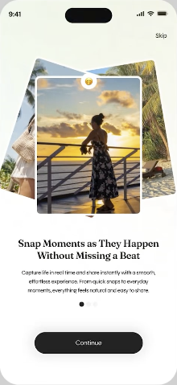
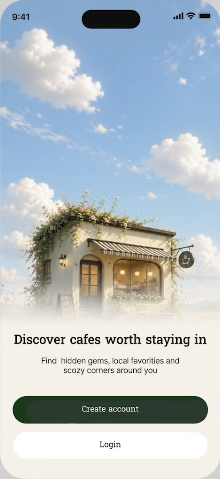
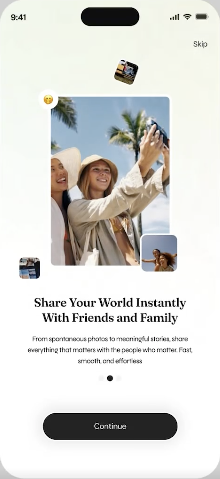
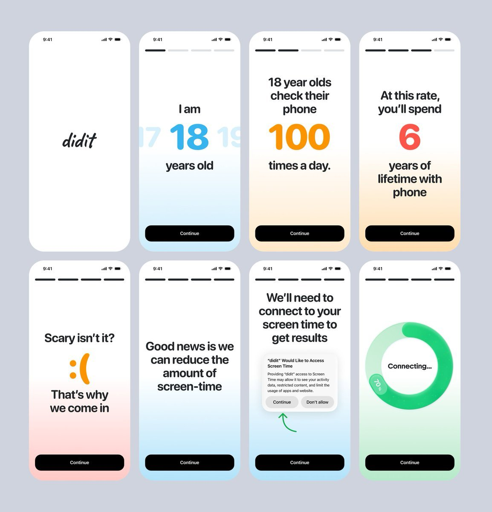

# Onboarding 风格目录

> 点击各风格名称查看完整规范；六屏拼图的提取说明见 [六种参考图风格](references/six-reference-styles.md)，设计流程见 [SKILL.md](SKILL.md)。

共 9 套风格。前六套按六屏原拼图从左到右、先上后下排列，后三套来自其他参考图；点击风格名称可查看完整 Style Profile。

| 参考图 | 风格 | 描述 | 色板 |
|---|---|---|---|
|  | **[薄荷叠片](styles/mint-photo-stack-v1.json)** `mint-photo-stack-v1` | 薄荷白底的上浅下白过渡；白边三层相片扇形叠放；居中衬线标题与黑色胶囊 CTA。 | `#F4F9EE` `#FFFFFF` `#232323` `#171917` `#4D514D` `#EAB85C` |
|  | **[晴空奶油](styles/sky-cream-dissolve-v1.json)** `sky-cream-dissolve-v1` | 蓝天白云占据上半部；奶油色雾化衔接照片与文案区；深森林绿胶囊主按钮。 | `#F5F0E8` `#FFFFFF` `#1B381A` `#181C17` `#50574E` `#90B4DA` `#F7F6F0` |
|  | **[瓷白彩格](styles/porcelain-pastel-grid-v1.json)** `porcelain-pastel-grid-v1` | 近瓷白底与白色圆角展示框；三列暖冷粉彩方格；上方居中无衬线标题与底部深色胶囊。 | `#F4F5F7` `#FFFFFF` `#272525` `#181A1C` `#50555C` `#EFC551` `#EEB8AE` `#E48865` `#BFE5E8` `#C7BDB2` |
|  | **[薄荷悬浮](styles/mint-photo-orbit-v1.json)** `mint-photo-orbit-v1` | 薄荷到白的轻柔底色；一大三小的疏散悬浮相片；居中衬线标题与黑色胶囊 CTA。 | `#F3F7ED` `#FFFFFF` `#232323` `#171917` `#4D514D` `#EAB85C` |
|  | **[炭黑荧光地图](styles/charcoal-lime-map-v1.json)** `charcoal-lime-map-v1` | 橄榄炭黑底色；深灰路网面板与单条柠檬黄路径；荧光胶囊 CTA 内嵌深色圆箭头。 | `#151512` `#34342F` `#F3F774` `#FFFFFF` `#CBCDC4` `#1D1D17` `#5D5F56` `#E9EF62` |
|  | **[电影感青蓝摄影](styles/cinematic-teal-photo-v1.json)** `cinematic-teal-photo-v1` | 灰蓝与深青蓝的满版摄影；左上白色短文案；底部悬浮白色胶囊 CTA。 | `#2D4959` `#FFFFFF` `#152E38` `#A2A3A8` `#172D35` `#BD9261` |
|  | **[浅彩底晕](styles/pastel-bottom-wash-v1.json)** `pastel-bottom-wash-v1` | 上白下浅彩的无缝垂直底晕；大块无纹理留白与黑色高对比交互；单一数字/弧形/圆环的低密度图形点缀。 | `#FFFFFF` `#CEECFD` `#FFE9C9` `#FFDEAF` `#FECBC8` `#B9EACC` `#000000` |
|  | **[薄荷流纹](styles/mint-organic-contours-v1.json)** `mint-organic-contours-v1` | 近白底上极低对比的宽圆头蜿蜒曲带；下部由左雾蓝到右薄荷绿的柔和双色底晕；轻线淡彩与深色胶囊行动按钮的清楚层级。 | `#FEFEFE` `#FFFFFF` `#E4F2F8` `#E5F8F1` `#0E0E0E` |
|  | **[粉彩纸趣](styles/pastel-paper-doodle-v1.json)** `pastel-paper-doodle-v1` | 白色留白中的低饱和纸片与局部奶油软晕；边缘裁切便签、圆拱或邮票齿边的纸品形状；稀疏、不完全规整的圆头细线涂鸦。 | `#FFFFFF` `#F2F2F2` `#FFF2C4` `#EAE2FA` `#FBE6DB` `#ECF1EB` `#EDF5F9` `#242A26` |

色值为截图局部代表值或重建规范，并非原始设计文件的精确参数。背景、前景图案与摄影层的边界，以及采样依据，均记录在对应 Profile 中。
